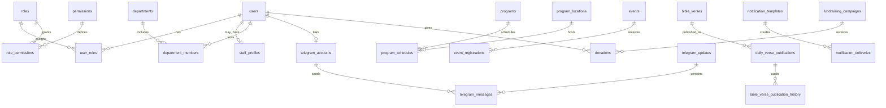

# Church platform backend

## Deployment

1. Copy `.env.example` to `.env`; use a new `JWT_SECRET` (at least 32 bytes), PostgreSQL credentials, and the real `WEB_ORIGIN`.
2. Run `npm run migrate`, then `npm run seed`. Seeds are idempotent. An initial administrator is created only when `INITIAL_ADMIN_EMAIL`, `INITIAL_ADMIN_PASSWORD`, and (`NODE_ENV=development|test` or `ALLOW_INITIAL_ADMIN=true`) are set. To bootstrap the one protected system owner, explicitly set `INITIAL_SYSTEM_OWNER_EMAIL` to that existing initial-admin account and `ALLOW_INITIAL_SYSTEM_OWNER=true` for that one seed run; remove both afterwards.
3. Start with `npm run start`. Never commit `.env`, bot tokens, passwords, or setup credentials.

`schema.sql` is the complete executable schema export for a fresh database; production deployments should use the ordered migrations instead.

## Architecture audit

The original project had a sound cookie/JWT registration and profile path, but its public content routes returned hard-coded empty arrays and its dashboard controls were not backed by management routes. The migrations now add normalized RBAC, pastoral/member workflow, event/program scheduling, verified Bible content, Telegram message/delivery records, finance, audit, settings, media, and organization data. The existing `users` table and frontend routes are retained.

### Entity relationships

`BIGINT GENERATED ALWAYS AS IDENTITY` is used consistently to stay compatible with the existing user keys. Monetary values are `NUMERIC(14,2)`, time is `TIMESTAMPTZ`, and deletion-sensitive modules use `deleted_at`. Foreign keys, partial uniqueness, idempotent Telegram update keys, event registration keys, publication-date uniqueness, and query indexes are in the migrations.

### Tables by responsibility

- Access: `users`, `roles`, `permissions`, `user_roles`, `role_permissions`, `audit_logs`, `system_settings`.
- People: `staff_profiles`, `departments`, `department_members`, `member_profiles`, `membership_applications`, `newcomer_followups`.
- Calendar/content: `programs`, `program_schedules`, `program_locations`, `events`, `event_registrations`, `organizations`, `bible_study_groups`, `bible_study_memberships`, `media_items`, `announcements`.
- Bible: `bible_verses` (verified, attributed source data), `daily_verse_publications`, and `bible_verse_publication_history`.
- Telegram/notifications: `telegram_accounts`, `telegram_link_tokens`, `telegram_updates`, `telegram_messages`, `telegram_notification_preferences`, `notification_templates`, `notification_deliveries`.
- Finance: `donation_categories`, `donations`, `partners`, `fundraising_campaigns`.
- Public correspondence: `contact_messages` holds website contact requests for a staff workflow.

## API contract

All successful list/read responses are `{ success: true, data, meta? }`; errors are `{ error }`. Session-authenticated endpoints use the secure `church_session` HTTP-only cookie.

- Public: `GET /api/public/events`, `/events/:id`, `/program-schedules`, `/verse`, `/announcements`, `/campaigns`, `/partners`, `/sermons`, `/banners`, `/organizations`, `/organizations/:id`, `/organizations/:id/departments`, `/departments/:id`, and `/bible-study-groups`. `POST /api/public/contact` accepts `{ name, email, phone?, subject, message }` and persists a visitor message.
- Account: `POST /api/auth/register|login|logout`, `GET /api/auth/me`, `GET|PATCH /api/users/me`, password/email/preference routes, and Telegram link/unlink routes documented in `API.md`.
- Events: staff with `events.manage` can `POST /api/events`, `PATCH|DELETE /api/events/:id`; members can `POST /api/events/:id/register`.
- Admin: `GET /api/admin/roles`, `POST /api/admin/users/:userId/roles`, `PATCH /api/admin/users/:userId/status`, `GET|PATCH /api/admin/settings`, `GET /api/admin/audit-logs`, `GET /api/admin/reports/:type`, `PUT /api/admin/verse`, and `POST /api/admin/announcements`.
- Telegram inbox: `POST /api/telegram/webhook`; administrators with `telegram.manage` use `GET /api/admin/telegram/messages` and `PATCH /api/admin/telegram/messages/:id` with `{ "status": "NEW|IN_PROGRESS|REPLIED|CLOSED" }`.

## Role baseline

| Role | Baseline permissions |
|---|---|
| ADMIN | All seeded permissions |
| PASTOR | Bible publishing, announcements, programs, events, membership |
| LEADER | Staff, programs, events |
| FINANCE | Finance and reports |
| REGISTRAR | Member viewing and membership workflow |
| STAFF, MEMBER, PARTNER | No management permission by default |

The server reloads role permissions on every authenticated request. Frontend navigation is only a convenience; authorization is enforced server-side.

## Telegram

Configure `TELEGRAM_BOT_TOKEN`, `TELEGRAM_BOT_USERNAME`, `TELEGRAM_WEBHOOK_URL`, and a random `TELEGRAM_WEBHOOK_SECRET`. Register the webhook with Telegram using that secret token. In webhook mode polling is disabled. The webhook authenticates the header, inserts `telegram_updates` with a unique update ID before processing, stores the sender/message, and returns duplicate updates safely.

The profile flow creates a 32-byte, hashed, one-use, ten-minute token. `/start <token>` links the actual Telegram numeric `from.id` and private chat, never a browser-provided username. Unlinking clears the website association and Telegram opt-in. Telegram delivery should be queued in `notification_deliveries`; do not publish private member or finance data to groups.

## Bible verse publishing

Only an attributed, verified record belongs in `bible_verses`; do not paste unlicensed translations. An authorized pastor uses `PUT /api/admin/verse` with `text`, `reference`, `sourceAttribution`, optional `reflection`, `explanation`, `publicationDate`, `publishToWebsite`, and `publishToTelegram`. Manual publications unpublish an automatic/publication for the same date. The scheduled job runs at 00:05 in `CHURCH_TIMEZONE`, avoids verses published in the previous 30 days, and is idempotent through a partial unique index.

## Optional map setup

The API supplies `/api/public/program-schedules` and `church.location` settings as the source of truth. To enable a Leaflet client screen, install `leaflet` and `leaflet-routing-machine`, use an administrator-configured `program_locations` record (latitude, longitude, address), and only call `watchPosition` after a visible **Navigate to Church** action. Stop its watch on exit/logout, throttle routing requests, and show the address when GPS, routing, or schedules fail. Use a contracted/reliable OSRM-compatible provider in production rather than assuming public demo capacity. No precise location should be sent to this server.
